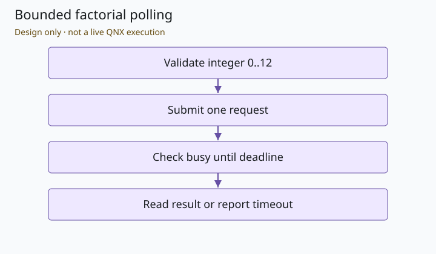
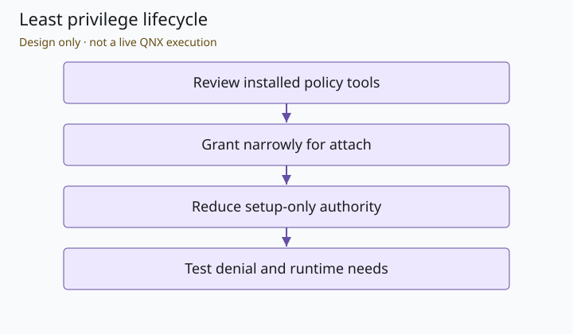

author: Mizzen Studios
summary: PCI ownership, bounded work and interrupt lifecycle for QNX 8.0
id: qnx-edu-kit
categories: QNX, PCI
environments: Web
status: Draft
feedback link: https://github.com/Mizzen-Studios/qnx-edu-kit/issues

# A first PCI driver for QNX® 8.0 — blocked draft

> Last live verified: NEVER. SDP build: PENDING. QSTI: PENDING. QNX-target QEMU pin/live evidence: PENDING (host QEMU 8.2.2 installed).
> This is a private teaching draft, not an executable target tutorial. Host contracts and models are available; no target implementation exists. Estimated durations are planning targets, not measured learner times. Do not publish until all live verification gates pass.

## 1. Setup
Duration: 8

Mini-map: [1] → 2 → 3 → 4 → 5 → 6

Establish reproducible host and evidence boundaries.


### Work through the contract

- Record host architecture, Python, make and QEMU version. ARM64 TCG is approved; KVM is not required.
- Keep SDKs, images and binaries outside the checkout, even ignored folders. Record authorized SDP build, QSTI version and image provenance when available.

### Acceptance boundary

A clean clone runs host checks without third-party Python packages; full verification remains blocked.

Intended build: a QEMU edu PCI teaching driver. Learn PCI discovery, mapped I/O, polling, an interrupt service thread and a resource manager. Intended finish line: writing 10 and reading 3628800 via /dev/edu on QNX; NOT achieved. Need an authorized local SDP 8.0, pinned QSTI/QEMU image and a verified target. No hardware required in the proposed path.

Record SDP build, QSTI and QEMU versions, image provenance, target architecture and permissions; validate a clean boot.

Host (repository root):

```sh
make check-step1
```

<details><summary>Current expected output</summary>

BLOCKED: step 1 live QNX check not implemented or verified. Nonzero exit; no target command is available.

</details>

Starter: [task](../steps/step1/starter/README.md). Solution: [acceptance specification only](../steps/step1/solution/README.md).

## 2. PCI server attach
Duration: 8

Mini-map: 1 → [2] → 3 → 4 → 5 → 6

Separate discovery from exclusive resource ownership.


### Work through the contract

- Review installed QNX 8.0 PCI server declarations. The discontinued legacy PCI API is not the porting target.
- Validate device identity, BAR type and extent, interrupt route and ownership. Unwind partial acquisition in reverse order; never continue with an invalid handle.

### Acceptance boundary

Missing device, duplicate owner and injected attach failures return nonzero without leaked resources.

Use locally reviewed QNX 8.0 PCI server declarations to enumerate and attach edu, inspect BAR metadata and detach cleanly.

Host (repository root):

```sh
make check-step2
```

<details><summary>Current expected output</summary>

BLOCKED: step 2 live QNX check not implemented or verified. Nonzero exit; no target command is available.

</details>

Starter: [task](../steps/step2/starter/README.md). Solution: [acceptance specification only](../steps/step2/solution/README.md).

## 3. ID and liveness
Duration: 4

Mini-map: 1 → 2 → [3] → 4 → 5 → 6

A mapped address is not proof of a device protocol.


### Work through the contract

- Register offsets and values remain withheld until every row has live pinned-QEMU evidence. Source inspection alone is insufficient.
- Validate width, alignment and bounds; check identity before writing. Test complementary liveness patterns and width-limited inverse readback. Unmap on failure.

### Acceptance boundary

Wrong identity, failed mapping and out-of-bounds requests are bounded errors, never PASS.

After every relevant checklist row has live evidence, map the validated BAR range and perform bounded ID/liveness checks.

Host (repository root):

```sh
make check-step3
```

<details><summary>Current expected output</summary>

BLOCKED: step 3 live QNX check not implemented or verified. Nonzero exit; no target command is available.

</details>

Starter: [task](../steps/step3/starter/README.md). Solution: [acceptance specification only](../steps/step3/solution/README.md).

## 4. Factorial polling
Duration: 4

Mini-map: 1 → 2 → 3 → [4] → 5 → 6

Use request ownership and a monotonic deadline.



### Work through the contract

- Accept decimal integers 0 through 12 for this unsigned 32-bit teaching contract; larger factorials overflow.
- Serialize requests; busy hardware cannot silently replace pending work. Read only after completion, and distinguish timeout from valid input zero.

### Acceptance boundary

Future QNX expectations: 0 and 1 return 1; 10 returns 3628800. These are mathematical expectations, not observed target results.

Implement a bounded wait, reject unsupported inputs, and observe the factorial finish line on the actual target.

Host (repository root):

```sh
make check-step4
```

<details><summary>Current expected output</summary>

BLOCKED: step 4 live QNX check not implemented or verified. Nonzero exit; no target command is available.

</details>

Starter: [task](../steps/step4/starter/README.md). Solution: [acceptance specification only](../steps/step4/solution/README.md).

## 5. Interrupt service thread
Duration: 10

Mini-map: 1 → 2 → 3 → 4 → [5] → 6

Teach standalone interrupt ownership rather than io-sock assumptions.


### Work through the contract

- Review actual InterruptAttachThread and InterruptWait declarations locally; no guessed signatures are supplied. Inspect IO and INTERRUPT abilities and active policy before attach.
- On EPERM capture the failing operation and inspect grants; do not recommend broad privilege. For INTx inspect owned status, acknowledge device sources, then follow documented unmask rules. InterruptAttachEvent is contextual for io-sock, not an interchangeable standalone sample.

### Acceptance boundary

Test shared/unrelated IRQ, stale status, timeout, missing ability and repeated attach/detach. Delivery alone does not establish completion.

Review current InterruptAttachThread and InterruptWait declarations locally; verify ability failures, INTx status, acknowledgement, unmasking and clean detach.

Host (repository root):

```sh
make check-step5
```

<details><summary>Current expected output</summary>

BLOCKED: step 5 live QNX check not implemented or verified. Nonzero exit; no target command is available.

</details>

Starter: [task](../steps/step5/starter/README.md). Solution: [acceptance specification only](../steps/step5/solution/README.md).

## 6. Resource manager
Duration: 10

Mini-map: 1 → 2 → 3 → 4 → 5 → [6]

Turn messages into a predictable client contract.


### Work through the contract

- Define bounded decimal input with optional newline, partial-write behavior, per-open result ownership and serialization. Cap message size before parsing.
- Implement partial reads, offsets and EOF, errors without stale output and cancellation using actual installed resmgr declarations. Publish readiness last; process death does not reset hardware.

### Acceptance boundary

Future target acceptance: write 10 to /dev/edu and read 3628800. Test concurrent clients, malformed input, partial reads, death and re-probe.

Review resource-manager handlers locally; implement bounded input, concurrency, partial reads and error handling; observe the finish line and safe re-probe.

Host (repository root):

```sh
make check-step6
```

<details><summary>Current expected output</summary>

BLOCKED: step 6 live QNX check not implemented or verified. Nonzero exit; no target command is available.

</details>

Starter: [task](../steps/step6/starter/README.md). Solution: [acceptance specification only](../steps/step6/solution/README.md).

## Congratulations — future acceptance only
Duration: 0

You are not finished until a real target transcript proves every core step and two fresh agents reproduce the codelab from clean clones. No congratulations or 44-minute completion claim is earned by host CI.

## Extra credit — not implemented
Duration: 0

DMA (estimated 10 minutes), restart/re-probe (4), tracing (5) are blocked. Validate the pinned QEMU DMA property, register semantics, physical-address handling and cache ownership before writing a DMA tutorial. Do not supply guessed commands or APIs.

## Navigation and support
Duration: 0

Mini-map: setup → PCI → ID/liveness → polling → IST → resmgr.

The [verification checklist](../docs/verification-checklist.md) holds candidate register work separately; no offsets or values are taught here. Eight accessible SVG design diagrams with matching Mermaid sources are provided; they depict contracts, NOT verified target flows. SVG layout is rendered by the local deterministic script rather than claiming claat or Mermaid CLI execution. Local static rendering is tested separately; upstream claat export remains untested.

See [troubleshooting and glossary](../docs/learning-notes.md).

## Security and extra-credit design
Duration: 0



The [policy specification](../docs/security-policy.md) is not validated secpol syntax. IO and INTERRUPT are review areas, not proof only two grants suffice. A deny test must fail for the intended reason, not a missing binary.


Host model values are source-derived, NOT QNX. Reject DMA ranges beyond the configured mask instead of relying on address clamping. Never substitute a virtual pointer for a bus address. Keep device-buffer and host-memory extents separate and verify cache ownership using actual target documentation.

The [restart contract](../docs/restart-policy.md) handles partial acquisition and stale state. Process replacement does not reset hardware. Trace commands are withheld until installed tool arguments are verified; no invented tracelogger flags or timing claims.

The [register evidence boundary](../docs/register-evidence.md) documents the actual Linux probe failure, not an SDK excuse. Mac and Windows paths remain UNTESTED.
