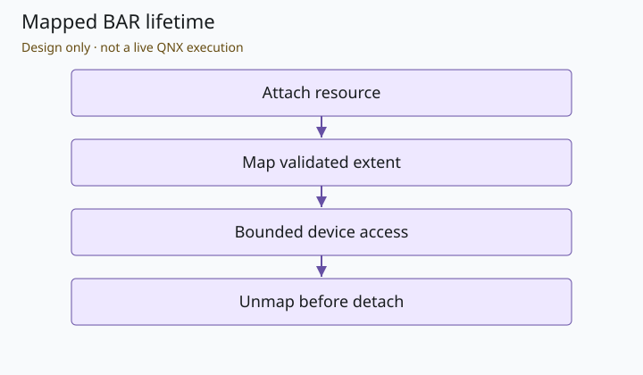
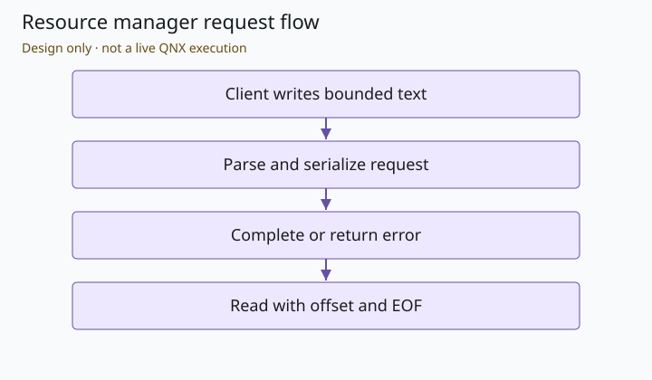
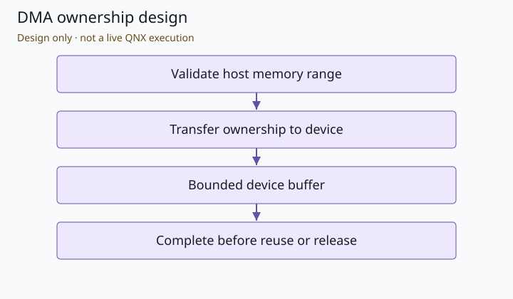

author: Mizzen Studios
summary: Verified E1 PCI, IAT IRQ, polled DMA and resource-manager teaching snapshots
id: qnx-edu-kit
categories: QNX, PCI
environments: Web
status: Draft
feedback link: https://github.com/Mizzen-Studios/qnx-edu-kit/issues

# Write your first QNX 8.0 PCI driver in QEMU — private E2 draft

## 1. Setup and evidence
Duration: 8

> PRIVATE DRAFT: durations are unmeasured planning estimates, not a learner completion claim. E1 commit 387ba38 has fresh native all-six-step functional PASS with valid resource caps. QSTI provenance remains unverified; this is a custom QNX 8 IFS, not a verified QSTI release. All twelve E2 snapshots have source-bound qcc compilation evidence, not per-snapshot learner runtime acceptance. Production safety, complete policy/restart/error injection and two fresh learners remain pending. Do not publish.

The current journey is a learner-owned fault-to-fix lab. Consult the canonical [capability ledger](../docs/capabilities.md). The [step3 learner journey](../docs/learner-lab.md) now records source/binary/image-bound wrong-edit FAIL and corrected-edit PASS in fresh native boots on the local E1 substrate. Clean learner BSP portability and other learner stages remain UNVERIFIED. The reference checks below remain intact and separate, not learner acceptance.

Start from the unchanged verified E1 implementation for comparison, not as a substitute for executing learner edits. Evidence: [native receipt](../docs/acceptance/native-20261107/receipt.json), [serial transcript](../docs/acceptance/native-20261107/serial.txt), [clean checkout receipt](../docs/acceptance/native-20261107/clean-checkout-receipt.json). These are historical artifacts, never input to live acceptance. [Build order and exact scope](../docs/e2-build-order.md).

Mini-map: [1] → 2 → 3 → 4 → 5 → 6


### Work through the source

Use uname to distinguish a real QNX process from a host build. Keep the licensed SDK, IFS, disk and build outputs outside the checkout. Record the authorized SDP 8.0 toolchain, x86_64 target, QEMU 8.2.2 TCG and image checksum. A host model is not a target.

Read the [starter task](../steps/step1/starter/README.md) and bounded TODO in [starter main.c](../steps/step1/starter/main.c). Compare the [solution explanation](../steps/step1/solution/README.md) and [solution main.c](../steps/step1/solution/main.c) only after attempting the boundary. These are actual source snapshots, not unconditional includes of an accumulated probe.

### Build and check

Host, repository root; no SDK or guest is started by the first two commands:


```sh
python3 tools/step_sources.py --check
./verify.sh --host-only
make check-reference-step1
```

The live command is owner-controlled: obtain the exclusive native lease and external source/image-bound bundle first. Without them it is BLOCKED (exit 2). It boots the accumulated unchanged E1 reference and requires ALL six markers plus IRQ resource-manager/client/shell checks, even when selecting step 1; it does not certify an edited learner binary or independently execute this snapshot. The source-contract check rejects modified snapshots before boot. Never supply saved transcripts or fixtures as live evidence.

Expected reference marker from a fresh successful target: EDU STEP1 PASS QNX target process. Retain the entire transcript and receipt, not this expected string.

## 2. PCI discovery and ownership
Duration: 8

Mini-map: 1 → [2] → 3 → 4 → 5 → 6


### Work through the source

Read main from ThreadCtl(IO_LEVEL_1) through pci_device_find and pci_device_attach. The tested x86 PCI module needs checked per-thread I/O level 1: no inherited level 2. Match vendor 0x1234/device 0x11e8; attach EXCLUSIVE and detach. Missing device or failed attach must stop, never dereference a bad handle.

Read the [starter task](../steps/step2/starter/README.md) and bounded TODO in [starter main.c](../steps/step2/starter/main.c). Compare the [solution explanation](../steps/step2/solution/README.md) and [solution main.c](../steps/step2/solution/main.c) only after attempting the boundary. These are actual source snapshots, not unconditional includes of an accumulated probe.

### Build and check

Host, repository root; no SDK or guest is started by the first two commands:


```sh
python3 tools/step_sources.py --check
./verify.sh --host-only
make check-reference-step2
```

The live command is owner-controlled: obtain the exclusive native lease and external source/image-bound bundle first. Without them it is BLOCKED (exit 2). It boots the accumulated unchanged E1 reference and requires ALL six markers plus IRQ resource-manager/client/shell checks, even when selecting step 2; it does not certify an edited learner binary or independently execute this snapshot. The source-contract check rejects modified snapshots before boot. Never supply saved transcripts or fixtures as live evidence.

Expected reference marker from a fresh successful target: EDU STEP2 PASS PCI server attach. Retain the entire transcript and receipt, not this expected string.

## 3. BAR mapping and liveness
Duration: 4

Mini-map: 1 → 2 → [3] → 4 → 5 → 6



### Work through the source

Read pci_device_read_ba and the BAR0 loop. Require a memory BAR, sufficient extent, and a valid mmap_device_memory result before MMIO. The verified reference maps 0x1000 bytes; the probe checks a smaller minimum extent whereas the resource manager requires the full mapping extent. Do not generalize that probe precondition to arbitrary hardware. At byte offsets 0x00 and 0x04, require ID 0x010000ed and the 32-bit complement of 0x12345678. Unmap and detach on every acquired-resource failure.

Read the [starter task](../steps/step3/starter/README.md) and bounded TODO in [starter main.c](../steps/step3/starter/main.c). Compare the [solution explanation](../steps/step3/solution/README.md) and [solution main.c](../steps/step3/solution/main.c) only after attempting the boundary. These are actual source snapshots, not unconditional includes of an accumulated probe.

### Build and check

Host, repository root; no SDK or guest is started by the first two commands:


```sh
python3 tools/step_sources.py --check
./verify.sh --host-only
make check-reference-step3
```

The live command is owner-controlled: obtain the exclusive native lease and external source/image-bound bundle first. Without them it is BLOCKED (exit 2). It boots the accumulated unchanged E1 reference and requires ALL six markers plus IRQ resource-manager/client/shell checks, even when selecting step 3; it does not certify an edited learner binary or independently execute this snapshot. The source-contract check rejects modified snapshots before boot. Never supply saved transcripts or fixtures as live evidence.

Expected reference marker from a fresh successful target: EDU STEP3 PASS BAR ID and complement. Retain the entire transcript and receipt, not this expected string.

## 4. Bounded factorial polling
Duration: 4

Mini-map: 1 → 2 → 3 → [4] → 5 → 6


### Work through the source

Read the status register at 0x20 (r[8]) and factorial at 0x08 (r[2]). Disable factorial IRQ for this polling exercise, submit 10, then test busy at most 1000 one-millisecond sleeps. Require completion and 3628800; an iteration budget is not a measured wall-clock guarantee. The client contract in step6 accepts only 0..12 to avoid unsigned 32-bit overflow.

Read the [starter task](../steps/step4/starter/README.md) and bounded TODO in [starter main.c](../steps/step4/starter/main.c). Compare the [solution explanation](../steps/step4/solution/README.md) and [solution main.c](../steps/step4/solution/main.c) only after attempting the boundary. These are actual source snapshots, not unconditional includes of an accumulated probe.

### Build and check

Host, repository root; no SDK or guest is started by the first two commands:


```sh
python3 tools/step_sources.py --check
./verify.sh --host-only
make check-reference-step4
```

The live command is owner-controlled: obtain the exclusive native lease and external source/image-bound bundle first. Without them it is BLOCKED (exit 2). It boots the accumulated unchanged E1 reference and requires ALL six markers plus IRQ resource-manager/client/shell checks, even when selecting step 4; it does not certify an edited learner binary or independently execute this snapshot. The source-contract check rejects modified snapshots before boot. Never supply saved transcripts or fixtures as live evidence.

Expected reference marker from a fresh successful target: EDU STEP4 PASS factorial polling. Retain the entire transcript and receipt, not this expected string.

## 5. IAT interrupt and polled DMA
Duration: 10

Mini-map: 1 → 2 → 3 → 4 → [5] → 6


### Work through the source

Read pci_device_read_irq, InterruptAttachThread and InterruptWait in the probe. Clear stale status (ack 0x64), attach with TRK_MSK, arm a two-second TimerTimeout, raise bit 1 at 0x60, verify own pending bit at 0x24 and acknowledge before detach. Default attach initially unmasks: an extra unmask at count zero returns EAGAIN. Then inspect edu_dma_roundtrip: contiguous uncached MAP_PHYS memory, mem_offset physical range inside 32-bit dma_mask, checked bus mastering, two bounded 64-byte transfers and byte comparison. QEMU device buffer starts at 0x40000; never substitute a virtual pointer for the physical bus address. DMA completion is POLLED, not an IRQ claim. On failed quiescence the reference retains the allocation until the bounded external VM owner stops it.

Read the [starter task](../steps/step5/starter/README.md) and bounded TODO in [starter main.c](../steps/step5/starter/main.c). Compare the [solution explanation](../steps/step5/solution/README.md) and [solution main.c](../steps/step5/solution/main.c) only after attempting the boundary. These are actual source snapshots, not unconditional includes of an accumulated probe.

### Build and check

Host, repository root; no SDK or guest is started by the first two commands:


```sh
python3 tools/step_sources.py --check
./verify.sh --host-only
make check-reference-step5
```

The live command is owner-controlled: obtain the exclusive native lease and external source/image-bound bundle first. Without them it is BLOCKED (exit 2). It boots the accumulated unchanged E1 reference and requires ALL six markers plus IRQ resource-manager/client/shell checks, even when selecting step 5; it does not certify an edited learner binary or independently execute this snapshot. The source-contract check rejects modified snapshots before boot. Never supply saved transcripts or fixtures as live evidence.

Expected reference marker from a fresh successful target: EDU STEP5 PASS IAT wait acknowledge. Retain the entire transcript and receipt, not this expected string.

Additional required evidence: EDU DMA 64-byte RAM->EDU->RAM byte-exact PASS (polled, no DMA IRQ claim). The IRQ marker alone cannot prove DMA success.

## 6. IAT-backed resource manager
Duration: 10

Mini-map: 1 → 2 → 3 → 4 → 5 → [6]



### Work through the source

Read factorial, parse_command, edu_write, edu_read and main in the resource-manager solution. One dispatch thread owns PCI, IAT and registers. Each synchronous successful write uses InterruptWait, checks pending AND not-busy, acknowledges and unmasks before publishing. No polling fallback. A write is one complete command: 1–2 ASCII digits, optional LF, maximum three bytes, 0..12. Nonblocking requests return EAGAIN; results have per-open snapshots, offsets and EOF. Register /dev/edu mode 0660 only after PCI/BAR/IAT setup; dispatch remains a long-running process.

Read the [starter task](../steps/step6/starter/README.md) and bounded TODO in [starter main.c](../steps/step6/starter/main.c). Compare the [solution explanation](../steps/step6/solution/README.md) and [solution main.c](../steps/step6/solution/main.c) only after attempting the boundary. These are actual source snapshots, not unconditional includes of an accumulated probe.

### Build and check

Host, repository root; no SDK or guest is started by the first two commands:


```sh
python3 tools/step_sources.py --check
./verify.sh --host-only
make check-reference-step6
```

The live command is owner-controlled: obtain the exclusive native lease and external source/image-bound bundle first. Without them it is BLOCKED (exit 2). It boots the accumulated unchanged E1 reference and requires ALL six markers plus IRQ resource-manager/client/shell checks, even when selecting step 6; it does not certify an edited learner binary or independently execute this snapshot. The source-contract check rejects modified snapshots before boot. Never supply saved transcripts or fixtures as live evidence.

Expected reference marker from a fresh successful target: EDU STEP6 PASS. Retain the entire transcript and receipt, not this expected string.

On the authorized QNX target with the reference manager running (do not start a second exclusive owner):


```sh
printf '10\n' > /dev/edu
cat /dev/edu
# 3628800
```

Require EDU RESMGR IRQ completion with input=10 result=3628800 ack=00000000, EDU RESMGR ACCEPT PASS and EDU_SHELL_RESULT=3628800 in the complete harness run. The manager alone does not emit the step6 acceptance marker; native/edu_accept.c and shell checks do. Partial reads, invalid input, range errors and nonblocking checks are exercised by that client; arbitrary concurrency and production recovery are not established.

## Congratulations — evidence, not elapsed time
Duration: 0

Mini-map: setup → PCI → BAR → polling → IAT + polled DMA → IAT resmgr.

You have a scoped reference to study, not a measured 44-minute learner result. E1 functional native PASS does not establish fresh-learner reproducibility, QSTI provenance, least-privilege policy or physical hardware safety. Keep those gates open.

## Security and DMA ownership
Duration: 0


Review failing operations and narrowly required abilities; do not solve EPERM by broadly granting everything. The [policy specification](../docs/security-policy.md) is not validated secpol syntax.



The reference is specific to the tested x86 QEMU PC with no IOMMU and dma_mask=0xffffffff. Do not transfer its uncached physical-memory strategy to arbitrary hardware. [Learning notes](../docs/learning-notes.md) and [claat export scope](../docs/claat-export.md) separate local host rendering, actual upstream export and live target execution. No CAN module is part of this course.
