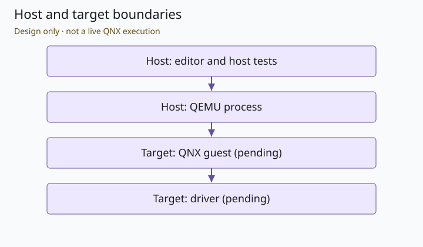
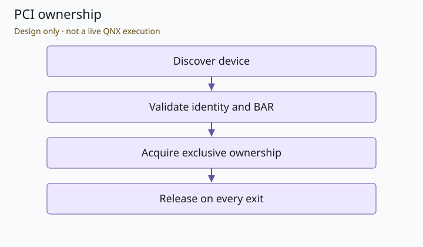
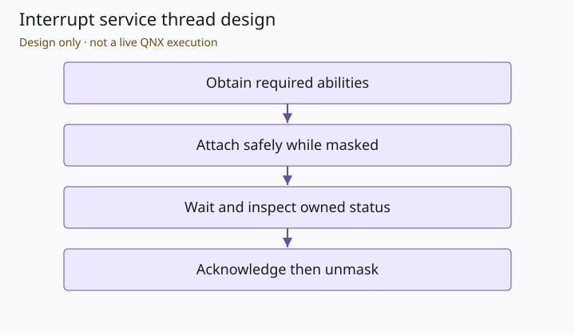

author: Mizzen Studios
summary: Own wrong-edit FAIL despite app exit0, corrected QNX PASS and /dev/edu normal I/O via split-host builds
id: qnx-edu-kit
categories: QNX, PCI
environments: Web
status: Published
feedback link: https://github.com/Mizzen-Studios/qnx-edu-kit/issues

# Make a convincing wrong edit — then build your own QNX /dev/edu

## 1. Your wrong-edit-to-/dev/edu tutorial
Duration: 8

> Deliberately fail your own edit despite exit 0, correct it, then implement normal /dev/edu I/O on QNX 8.0. Advanced lab: needs an existing QNX SDP 8.0 install and QEMU.

<!-- BEGIN CANONICAL TUTORIAL: generated by tools/tutorial_copy.py -->

### Canonical learner tutorial — trap first, working stock /dev/edu

### Start with the trap, not the SDK

A wrong write12345679 can return edcba986 and exit0: **FAIL despite application exit0** against the intended12345678→edcba987 oracle. Predict, edit, observe, diagnose, correct, rebuild and explain. The normal-I/O finish is **10→3628800** with real IRQ acknowledgement and a same-owner private pulse, not a second IST or worker. A self-declared PASS, saved log or HOST test cannot complete your source.

### Working stock recipe — bounded, explicit artifact reuse

The Nov13 SDK512MiB OOM is [preserved history](../docs/acceptance/stock-20261113/NOTES.md), not the current stock blocker. [SDK1GiB stock generation and wrong/correct gates](../docs/acceptance/stock-retry-20261113/RESULT.md) succeeded. The [11:03 finish receipt](../docs/acceptance/irq-retry-20261113/RESULT.md) records actual10→3628800, IRQack0, private pulse and finite slog2 with explicit --pci-line. API10 versus config11 was observed; default API attachment timed out in that stock setup. Selecting the read-only existing line is not a routing rewrite or a general PCI API/portability claim.

This recipe builds **fresh own application source/object/ELF**, then **REUSES** those approved stock IFS/disk artifacts. It does NOT reproduce image generation or a fresh SDK installation. Missing disclosed artifacts means stop: BLOCKED, not substitute a custom IFS, old ELF or reference receipt. The distinct stock adapter rejects custom manifests and unapproved artifact hashes. The old custom-IFS runner remains separate [historical material](../docs/learner-route-custom-legacy.md).

The [fresh clean-clone checkpoint](../docs/acceptance/coldreader-stock-20261113/RESULT.md) followed this stock-reuse path with new own registration/source/ELF. One native run passed; a byte-exact CRLF notebook-validator fix was then verified offline before the41-file OWN export. Its failed initial host validation is preserved; no second native run or image build.

### Prerequisite gate — existing licensed platform only

- Existing licensed SDP8.0 Linux x86_64 SDK guest, qnx user and existing environment file; no installation, activation, login or second SDK.
- Existing reviewed guestctl-capped.py controller with sibling shared/ directory mounted in the SDK as /mnt/host, ready marker and qemu.pid; supports EDU_SDK_MEMORY_MIB=1024 opt-in. This is an explicit owner-lab external dependency, not a turnkey fresh-machine setup.
- HOST QEMU, qemu-img, systemd user scopes and sole lease /home/ubuntu/qnx-host/native-test.lock. No other QEMU or queued SDK job. One owner across SDK then native.
- SDK Linux guest **1GiB**; HOST **2GiB**, TCG256MiB, reserve64MiB, CPU100%, nice15, smp1, swap0. Native QNX target **512MiB**, smp1. Do not activate/create/resize swap or change platform/packages, IRQ routing or caps.
- Approved licensed stock directory containing ifs.bin, disk-qemu, disk-qemu.vmdk, qemu_options and options, all checked against scripts/learner_stock.py PINS. IFS SHA25668bbe1b49a9b723c09d152773ee323ec6ab576eb29de933bfe3f08fdae21c753; disk SHA2560aee00c281f8eeb5b02c66555ed9517e317bb1503002a19dbf2b0155de336532. Get the actual files through your existing legal local handoff, never Git/public upload.

The known generation recipe, already observed at SDK1GiB, was a fresh directory with local/snippets/qemu_options.edu containing exactly -device edu, then:

```sh
mkqnximage --type=qemu --arch=x86_64 --ram=512M --cpu=1 --ssh-ident=none --build
```

The installed runimage consumes generated output/build/qemu_options as QEMU_OPTIONS. Do not invent --run='-device edu'. No lesson/startup/custom IFS snippets. **Skip image generation in this cold-reader recipe**: reuse the hashes above; a different rebuild requires a separately reviewed artifact pin, not relabeling. --ram=512M is the TARGET, not the SDK builder's RAM.

### Choose the bounded scope

For a full wrong → correct → finish result, follow the [coherent own-session checklist](../docs/coherent-journey.md) using the commands below. The earlier step6-only checkpoint is historical scoped evidence, not a complete wrong/correct journey. The [new coherent aggregate receipt](../docs/acceptance/coherent-stock-20261113/RESULT.md) now records wrongFAIL/app0 → correctedPASS → finishPASS and108-file OWN export at exact runtime source769a4c906c6b172c3624f8fe897b71e3c5d7e6b8. Later documentation SHA changes are not native reruns. Never pre-create the corrected source before observing the wrong failure.

### 1. Full clean Git clone and a fresh own notebook — HOST

Set these operator-supplied absolute paths (no spaces), and a fresh case name. The SDK shared mount must contain both the clone and your own notebook. Existing Git access only; no new login.

```sh
export EDU_CONTROLLER=/absolute/path/to/guestctl-capped.py
export EDU_SHARE="$(dirname "$EDU_CONTROLLER")/shared"
export EDU_CASE=edu-coldreader-20261113-1208
export EDU_BASE="$EDU_SHARE/$EDU_CASE"
export EDU_STOCK=/absolute/path/to/approved/stock-output
export EDU_SDP_ENV=/home/qnx/qnx800/qnxsdp-env.sh
mkdir "$EDU_BASE"
git clone https://github.com/Mizzen-Studios/qnx-edu-kit.git "$EDU_BASE/repo"
export EDU_REPO="$EDU_BASE/repo"
export EDU_WORK="$EDU_BASE/own"
cd "$EDU_REPO"
git rev-parse HEAD
git rev-parse --is-shallow-repository
python3 -c 'import sys;sys.path.insert(0,"scripts");import learner_stock as s;print(s.stock_inputs(sys.argv[1]))' "$EDU_STOCK"
if test -f "$EDU_WORK/session.json"; then
  python3 "$EDU_REPO/scripts/learner_session.py" render --work "$EDU_WORK"
else
  python3 "$EDU_REPO/scripts/learner_session.py" init --work "$EDU_WORK"
fi
```

Use a full Git clone, NOT git archive or a shallow snapshot: frozen historical evidence pins need Git history. The source checkout must initially be clean; learner edits belong outside it. The cockpit is HOST notes/UI, not a browser shell. Its stock commands are explicitly SDK vs HOST. Nativefresh labels only this notebook's own invoked observation, never independent human attestation.

Save a prediction before building. Create notes.json with this notebook's session_id, stage step6, prediction (expected factorial(10)=3628800 and explicit existing config line), diagnosis and explanation strings, then:

```sh
python3 scripts/learner_session.py notes --work "$EDU_WORK" --file "$EDU_BASE/notes.json"
```

This bounded cold-reader checkpoint is **step6 finish only**: already proved wrong/correct gates need not be repeated. Its new export must leave this session's untouched step3 CURRENT_STAGE_NOT_VALIDATED. A full new learner journey still needs its own wrong observation before correction; the historical [wrong-native.log](../docs/acceptance/wrapper-20261108/wrong-native.log), [correct-native.log](../docs/acceptance/wrapper-20261108/correct-native.log) and [finish-native.log](../docs/acceptance/wrapper-20261108/finish-native.log) cannot supply it.

### 2. Complete your own step6 registration

Edit EDU_WORK/step6/main.c, not a reference solution or old successful receipt. Replace only the registration TODO with your own dispatch_create, iofunc_func_init, io_funcs.read=edu_read/write=edu_write, mode0660 attribute plus owner uid/gid, iofunc_mount_init and per-open OCB functions, resmgr_attach on /dev/edu, dispatch_context_alloc and the same-owner dispatch loop (handle EINTR). Publish /dev/edu after handler setup. Keep the bounded existing handlers, real InterruptWait/own-bit/ack path and private pulse handoff. Print a uniquely named readiness line. The current starter already understands --pci-line; do not hardcode11 or write PCI routing. Record your edited source SHA256.

### 3. Build only the application — SDK guest, serial

Define EDU_GUEST_REPO=/mnt/host/$EDU_CASE/repo and EDU_GUEST_WORK=/mnt/host/$EDU_CASE/own. EDU_GUEST_SOURCE is EDU_GUEST_WORK/step6/main.c; EDU_HOST_SOURCE is EDU_WORK/step6/main.c: same bytes, different namespace. Preserve the same notebook/session tree through the mount; no receipt imports.

Create EDU_BASE/build.sh on HOST containing the following SDK-root dispatch, substituting your actual EDU_CASE and existing environment path literally:

```sh
#!/bin/bash
set -euo pipefail
G=/mnt/host/edu-coldreader-20261113-1208
chown -R qnx:qnx "$G/own"
runuser -u qnx -- env HOME=/home/qnx python3 "$G/repo/scripts/learner_session.py" build --work "$G/own" --stage step6 --stock approved-stock-reuse --sdp-env /home/qnx/qnx800/qnxsdp-env.sh
```

The build action selects a fresh, immutable attempt bundle. It serially runs qcc compile -O0 -g0 then link with pci/slog2; **no mkifs**. Its manifest kind is learner-stock-step6-v1, never learner-dev-edu-v1 custom IFS. Predictions, source/object/ELF digests and build command/rc are notebook-owned.

**STOP/REAP barrier:** the SDK must be stopped and reaped, its owner receipt checked, and the actual lease FREE before native starts.

HOST starts the already installed SDK through the bounded owner, dispatches exactly one build, and stops/reaps even on a failed build. No SDK/native overlap:

```sh
set -e
mkdir "$EDU_BASE/sdk-control"
python3 scripts/stock_sdk_owner.py --controller "$EDU_CONTROLLER" --control "$EDU_BASE/sdk-control" > "$EDU_BASE/sdk-owner.log" 2>&1 &
SDK_OWNER=$!
trap 'touch "$EDU_BASE/sdk-control/STOP"; wait "$SDK_OWNER"' EXIT
for attempt in $(seq 1 310); do
  test -f "$EDU_BASE/sdk-control/SDK_READY" && break
  kill -0 "$SDK_OWNER" || exit 1
  sleep 2
done
test -f "$EDU_BASE/sdk-control/SDK_READY"
python3 "$EDU_CONTROLLER" exec "$EDU_BASE/build.sh" 600
touch "$EDU_BASE/sdk-control/STOP"
wait "$SDK_OWNER"
trap - EXIT
python3 -c 'import json,sys;r=json.load(open(sys.argv[1]));assert r["stopped_reaped"] and r["status"]=="REQUESTED_STOP";print(r)' "$EDU_BASE/sdk-control/sdk-owner.json"
if pgrep -af '^qemu-system-'; then exit 1; fi # rc1 means absent
flock -n /home/ubuntu/qnx-host/native-test.lock true
```

The owner checks effective caps, SDK1GiB and reserve64, samples memory/process RSS including shutdown. Missing legal SDK or any breach is BLOCKED and stop, never a cap increase/retry. Require actual SDK reaping and FREE lease before proceeding.

### 4. One stock native observation — HOST only

```sh
env EDU_NATIVE_LEASE=granted python3 scripts/learner_session.py run --work "$EDU_WORK" --stage step6 --stock "$EDU_STOCK" --timeout 600
```

The distinct stock console holds the sole lock, refuses another QEMU, boots a new writable runtime overlay over unchanged stock (not image regeneration), nic none, then transfers your fresh ELF in bounded serial chunks. It verifies exact guest byte readback before execution, invokes --pci-line, does one normal write10/read, captures finite slog2 and stops/reaps. Require STOCK_NATIVE_PASS, source/ELF binding, actual3628800, IRQcompletion1/ack00000000, same-owner pulse sent1/received1, matching slog2 and unchanged IFS/disk. A changed source invalidates the prior current-source badge.

Serial transfer is the tested route. SSH boot faults and networking/SSH health remain **UNVERIFIED**; no scp success is assumed or repaired. Optional trace NOT_RUN in this finish-only scope. Optional secpol probes are read-only; no approved nondisplacing loaded policy means **BLOCKED**, not fabricated deny/allow or permission PASS. No MSI-X, C6 or CAN work.

### 5. Explain and export OWN evidence — HOST

Update diagnosis/explanation notes after the actual observation and import with the same notes command. Then:

```sh
python3 scripts/learner_session.py export --work "$EDU_WORK" --out "$EDU_BASE/own-export"
python3 - "$EDU_BASE/own-export" <<'PY'
from pathlib import Path
import hashlib,json,sys
p=Path(sys.argv[1]);m=json.loads((p/'pack.json').read_text())
for name,digest in m['files'].items():
    assert hashlib.sha256((p/name).read_bytes()).hexdigest()==digest,name
print('OWN_EXPORT_VERIFIED',len(m['files']))
print(m['current_sources'])
PY
```

Export validates by action, own matching source/build, distinct stock driver, target readback, log/oracle, base-image bindings and actual resource caps/reaping—not display labels. It contains private licensed stock assets locally; no upload. It is not a reference-receipt import or a relabeled custom-IFS run. Preserve failures; never overwrite attempts. Lower-level receipt prefixes produce PREFIX.json and PREFIX.log (plus private native.control directory).

### Recover only a completed own observation after a host-validator fix

If an older notebook reports BLOCKED despite a completed stock driver, preserve it and inspect its validation error. After correcting the host validator, `python3 scripts/learner_session.py revalidate --work "$EDU_WORK" --attempt 0002-step6-run` checks that own attempt again **offline**, preserves its prior notebook under supplemental/, and never starts SDK/QEMU or alters raw receipts. A changed log/source/stock binding still fails. This is not a retry, receipt import or claim of fresh execution; choose the actual blocked attempt ID. Export only after validation succeeds.

Stop after the one permitted observation; verify no QEMU and FREE actual lease; leave independent owner review pending. Single-host remains BLOCKED_NATIVE_TIMEOUT, cause UNVERIFIED, and is not retried. Historical BLOCKED_STOCK_MKIFS_OOM and the earlier stock512 OOM remain immutable, not today's stock status. No full-platform, human-learning, fresh-install, timing/performance/safety or public-media claim.

<!-- END CANONICAL TUTORIAL -->

### Historical reference appendix begins here — NOT learner acceptance

The remaining numbered sections preserve reference explanations, not additional
mandatory learner stages. Never substitute their reference checks for your edits.

Start from the unchanged verified E1 implementation for comparison, not as a substitute for executing learner edits. Evidence: [native receipt](../docs/acceptance/native-20261107/receipt.json), [serial transcript](../docs/acceptance/native-20261107/serial.txt), [clean checkout receipt](../docs/acceptance/native-20261107/clean-checkout-receipt.json). These are historical artifacts, never input to live acceptance. [Build order and exact scope](../docs/e2-build-order.md).

Mini-map: [1] → 2 → 3 → 4 → 5 → 6



### Work through the source

Use uname to distinguish a real QNX process from a host build. Keep the licensed SDK, IFS, disk and build outputs outside the checkout. Record the authorized SDP 8.0 toolchain, x86_64 target, QEMU 8.2.2 TCG and image checksum. A host model is not a target.

Read the [starter task](../steps/step1/starter/README.md) and bounded TODO in [starter main.c](../steps/step1/starter/main.c). Compare the [solution explanation](../steps/step1/solution/README.md) and [solution main.c](../steps/step1/solution/main.c) only after attempting the boundary. These are actual source snapshots, not unconditional includes of an accumulated probe.

### Build and check

Host, repository root; no SDK or guest is started by the first two commands:


```sh
python3 tools/step_sources.py --check
./verify.sh --host-only
make check-reference-step1
```

The live command is owner-controlled: obtain the exclusive native lease and external source/image-bound bundle first. Without them it is BLOCKED (exit 2). It boots the accumulated unchanged E1 reference and requires ALL six markers plus IRQ resource-manager/client/shell checks, even when selecting step 1; it does not certify an edited learner binary or independently execute this snapshot. The source-contract check rejects modified snapshots before boot. Never supply saved transcripts or fixtures as live evidence.

Expected reference marker from a fresh successful target: EDU STEP1 PASS QNX target process. Retain the entire transcript and receipt, not this expected string.

## 2. PCI discovery and ownership
Duration: 8

Mini-map: 1 → [2] → 3 → 4 → 5 → 6



### Work through the source

Read main from ThreadCtl(IO_LEVEL_1) through pci_device_find and pci_device_attach. The tested x86 PCI module needs checked per-thread I/O level 1: no inherited level 2. Match vendor 0x1234/device 0x11e8; attach EXCLUSIVE and detach. Missing device or failed attach must stop, never dereference a bad handle.

Read the [starter task](../steps/step2/starter/README.md) and bounded TODO in [starter main.c](../steps/step2/starter/main.c). Compare the [solution explanation](../steps/step2/solution/README.md) and [solution main.c](../steps/step2/solution/main.c) only after attempting the boundary. These are actual source snapshots, not unconditional includes of an accumulated probe.

### Build and check

Host, repository root; no SDK or guest is started by the first two commands:


```sh
python3 tools/step_sources.py --check
./verify.sh --host-only
make check-reference-step2
```

The live command is owner-controlled: obtain the exclusive native lease and external source/image-bound bundle first. Without them it is BLOCKED (exit 2). It boots the accumulated unchanged E1 reference and requires ALL six markers plus IRQ resource-manager/client/shell checks, even when selecting step 2; it does not certify an edited learner binary or independently execute this snapshot. The source-contract check rejects modified snapshots before boot. Never supply saved transcripts or fixtures as live evidence.

Expected reference marker from a fresh successful target: EDU STEP2 PASS PCI server attach. Retain the entire transcript and receipt, not this expected string.

## 3. BAR mapping and liveness
Duration: 4

Mini-map: 1 → 2 → [3] → 4 → 5 → 6


### Work through the source

Read pci_device_read_ba and the BAR0 loop. Require a memory BAR, sufficient extent, and a valid mmap_device_memory result before MMIO. The verified reference maps 0x1000 bytes; the probe checks a smaller minimum extent whereas the resource manager requires the full mapping extent. Do not generalize that probe precondition to arbitrary hardware. At byte offsets 0x00 and 0x04, require ID 0x010000ed and the 32-bit complement of 0x12345678. Unmap and detach on every acquired-resource failure.

Read the [starter task](../steps/step3/starter/README.md) and bounded TODO in [starter main.c](../steps/step3/starter/main.c). Compare the [solution explanation](../steps/step3/solution/README.md) and [solution main.c](../steps/step3/solution/main.c) only after attempting the boundary. These are actual source snapshots, not unconditional includes of an accumulated probe.

### Build and check

Host, repository root; no SDK or guest is started by the first two commands:


```sh
python3 tools/step_sources.py --check
./verify.sh --host-only
make check-reference-step3
```

The live command is owner-controlled: obtain the exclusive native lease and external source/image-bound bundle first. Without them it is BLOCKED (exit 2). It boots the accumulated unchanged E1 reference and requires ALL six markers plus IRQ resource-manager/client/shell checks, even when selecting step 3; it does not certify an edited learner binary or independently execute this snapshot. The source-contract check rejects modified snapshots before boot. Never supply saved transcripts or fixtures as live evidence.

Expected reference marker from a fresh successful target: EDU STEP3 PASS BAR ID and complement. Retain the entire transcript and receipt, not this expected string.

## 4. Bounded factorial polling
Duration: 4

Mini-map: 1 → 2 → 3 → [4] → 5 → 6


### Work through the source

Read the status register at 0x20 (r[8]) and factorial at 0x08 (r[2]). Disable factorial IRQ for this polling exercise, submit 10, then test busy at most 1000 one-millisecond sleeps. Require completion and 3628800; an iteration budget is not a measured wall-clock guarantee. The client contract in step6 accepts only 0..12 to avoid unsigned 32-bit overflow.

Read the [starter task](../steps/step4/starter/README.md) and bounded TODO in [starter main.c](../steps/step4/starter/main.c). Compare the [solution explanation](../steps/step4/solution/README.md) and [solution main.c](../steps/step4/solution/main.c) only after attempting the boundary. These are actual source snapshots, not unconditional includes of an accumulated probe.

### Build and check

Host, repository root; no SDK or guest is started by the first two commands:


```sh
python3 tools/step_sources.py --check
./verify.sh --host-only
make check-reference-step4
```

The live command is owner-controlled: obtain the exclusive native lease and external source/image-bound bundle first. Without them it is BLOCKED (exit 2). It boots the accumulated unchanged E1 reference and requires ALL six markers plus IRQ resource-manager/client/shell checks, even when selecting step 4; it does not certify an edited learner binary or independently execute this snapshot. The source-contract check rejects modified snapshots before boot. Never supply saved transcripts or fixtures as live evidence.

Expected reference marker from a fresh successful target: EDU STEP4 PASS factorial polling. Retain the entire transcript and receipt, not this expected string.

## 5. IAT interrupt and polled DMA
Duration: 10

Mini-map: 1 → 2 → 3 → 4 → [5] → 6



### Work through the source

Read pci_device_read_irq, InterruptAttachThread and InterruptWait in the probe. Clear stale status (ack 0x64), attach with TRK_MSK, arm a two-second TimerTimeout, raise bit 1 at 0x60, verify own pending bit at 0x24 and acknowledge before detach. Default attach initially unmasks: an extra unmask at count zero returns EAGAIN. Then inspect edu_dma_roundtrip: contiguous uncached MAP_PHYS memory, mem_offset physical range inside 32-bit dma_mask, checked bus mastering, two bounded 64-byte transfers and byte comparison. QEMU device buffer starts at 0x40000; never substitute a virtual pointer for the physical bus address. DMA completion is POLLED, not an IRQ claim. On failed quiescence the reference retains the allocation until the bounded external VM owner stops it.

Read the [starter task](../steps/step5/starter/README.md) and bounded TODO in [starter main.c](../steps/step5/starter/main.c). Compare the [solution explanation](../steps/step5/solution/README.md) and [solution main.c](../steps/step5/solution/main.c) only after attempting the boundary. These are actual source snapshots, not unconditional includes of an accumulated probe.

### Build and check

Host, repository root; no SDK or guest is started by the first two commands:


```sh
python3 tools/step_sources.py --check
./verify.sh --host-only
make check-reference-step5
```

The live command is owner-controlled: obtain the exclusive native lease and external source/image-bound bundle first. Without them it is BLOCKED (exit 2). It boots the accumulated unchanged E1 reference and requires ALL six markers plus IRQ resource-manager/client/shell checks, even when selecting step 5; it does not certify an edited learner binary or independently execute this snapshot. The source-contract check rejects modified snapshots before boot. Never supply saved transcripts or fixtures as live evidence.

Expected reference marker from a fresh successful target: EDU STEP5 PASS IAT wait acknowledge. Retain the entire transcript and receipt, not this expected string.

Additional required evidence: EDU DMA 64-byte RAM->EDU->RAM byte-exact PASS (polled, no DMA IRQ claim). The IRQ marker alone cannot prove DMA success.

## 6. IAT-backed resource manager
Duration: 10

Mini-map: 1 → 2 → 3 → 4 → 5 → [6]


### Work through the source

Read factorial, parse_command, edu_write, edu_read and main in the resource-manager solution. One dispatch thread owns PCI, IAT and registers. Each synchronous successful write uses InterruptWait, checks pending AND not-busy, acknowledges and unmasks before publishing. No polling fallback. A write is one complete command: 1–2 ASCII digits, optional LF, maximum three bytes, 0..12. Nonblocking requests return EAGAIN; results have per-open snapshots, offsets and EOF. Register /dev/edu mode 0660 only after PCI/BAR/IAT setup; dispatch remains a long-running process.

Read the [starter task](../steps/step6/starter/README.md) and bounded TODO in [starter main.c](../steps/step6/starter/main.c). Compare the [solution explanation](../steps/step6/solution/README.md) and [solution main.c](../steps/step6/solution/main.c) only after attempting the boundary. These are actual source snapshots, not unconditional includes of an accumulated probe.

### Build and check

Host, repository root; no SDK or guest is started by the first two commands:


```sh
python3 tools/step_sources.py --check
./verify.sh --host-only
make check-reference-step6
```

The live command is owner-controlled: obtain the exclusive native lease and external source/image-bound bundle first. Without them it is BLOCKED (exit 2). It boots the accumulated unchanged E1 reference and requires ALL six markers plus IRQ resource-manager/client/shell checks, even when selecting step 6; it does not certify an edited learner binary or independently execute this snapshot. The source-contract check rejects modified snapshots before boot. Never supply saved transcripts or fixtures as live evidence.

Expected reference marker from a fresh successful target: EDU STEP6 PASS. Retain the entire transcript and receipt, not this expected string.

On the authorized QNX target with the reference manager running (do not start a second exclusive owner):


```sh
printf '10\n' > /dev/edu
cat /dev/edu
# 3628800
```

Require EDU RESMGR IRQ completion with input=10 result=3628800 ack=00000000, EDU RESMGR ACCEPT PASS and EDU_SHELL_RESULT=3628800 in the complete harness run. The manager alone does not emit the step6 acceptance marker; native/edu_accept.c and shell checks do. Partial reads, invalid input, range errors and nonblocking checks are exercised by that client; arbitrary concurrency and production recovery are not established.

## Congratulations — evidence, not elapsed time
Duration: 0

Mini-map: setup → PCI → BAR → polling → IAT + polled DMA → IAT resmgr.

You have a scoped reference to study, not a measured 44-minute learner result. E1 functional native PASS does not establish fresh-learner reproducibility, QSTI provenance, least-privilege policy or physical hardware safety. Keep those gates open.

## Security and DMA ownership
Duration: 0


Review failing operations and narrowly required abilities; do not solve EPERM by broadly granting everything. The [policy specification](../docs/security-policy.md) is not validated secpol syntax.


The reference is specific to the tested x86 QEMU PC with no IOMMU and dma_mask=0xffffffff. Do not transfer its uncached physical-memory strategy to arbitrary hardware. [Learning notes](../docs/learning-notes.md) and [claat export scope](../docs/claat-export.md) separate local host rendering, actual upstream export and live target execution. No CAN module is part of this course.

### Scoped learner /dev/edu result — 7 November 2026

Edited step6 starter on the same fresh stock generic platform passed actual normal write/read10→3628800 and IRQ completion/ack. Source, binary, image, disk and caps are bound in the [learner finish evidence](../docs/acceptance/learner-finish-clean-20261107/NOTES.md). No reference checker, host result injection or polling fallback. Earlier failures remain; startup Memory fault still excludes a healthy-SSH/all-platform claim. Owner completion gate is CONDITIONAL, receipt-inspected not re-run; no safety/timing acceptance; C6 stays STOPPED.
